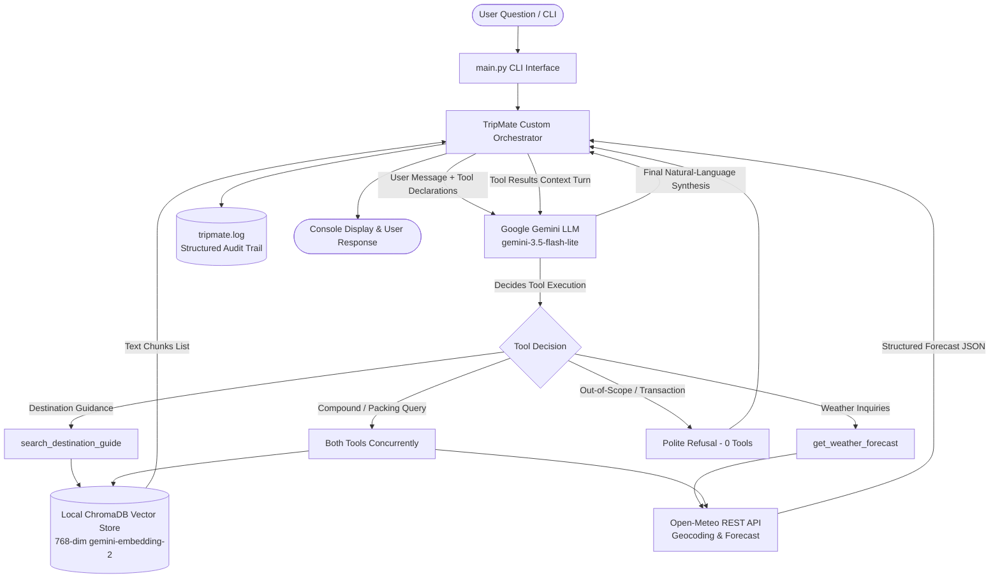

# TripMate — AI Travel Planning Agent

This repository contains my implementation of the TripMate technical assessment. The project implements a conversational travel planning agent that dynamically coordinates curated destination knowledge (via local RAG) with real-time weather forecasts (via Open-Meteo) using Google Gemini.

Rather than relying on high-level frameworks like LangChain or CrewAI, I built the agent orchestrator from scratch using the official `google-genai` SDK. This approach keeps dependencies minimal, avoids black-box abstractions, and provides full control over tool dispatching, execution latency tracking, and error handling.

---

## Table of Contents
1. [Architecture & Request Flow](#architecture--request-flow)
2. [Tool Schemas & Declarations](#tool-schemas--declarations)
3. [Setup & Quickstart](#setup--quickstart)
4. [Running the Application](#running-the-application)
5. [Automated Test Suite](#automated-test-suite)
6. [Design Decisions & Assumptions](#design-decisions--assumptions)
7. [Tool Selection & Multi-Tool Reasoning](#tool-selection--multi-tool-reasoning)
8. [Scope Awareness & Error Handling](#scope-awareness--error-handling)
9. [Structured Logging](#structured-logging)
10. [Example Execution Traces](#example-execution-traces)
11. [Known Limitations](#known-limitations)
12. [Future Improvements](#future-improvements)
13. [Scalability Considerations](#scalability-considerations)

---

## Architecture & Request Flow

### Architecture Diagram



### Component Flow Breakdown
1. **Agent / Orchestrator Layer (`src/agent/orchestrator.py`):**
   - Implements a custom loop using Google GenAI SDK with automatic function calling disabled (`automatic_function_calling: disable=True`).
   - Manages tool dispatch, measures execution latency in milliseconds, enforces a 5-turn loop guard, and handles model fallback (`gemini-3.5-flash-lite` → `gemini-flash-lite-latest`) in case of 429 rate limits.
2. **Destination Guide Tool (`src/tools/destination.py`, `src/rag/`):**
   - Indexes destination guides (`bangkok.txt`, `barcelona.txt`, `reykjavik.txt`, `tokyo.txt`) into a persistent ChromaDB collection using `gemini-embedding-2` (768 dimensions).
   - Retrieves section-level chunks via cosine similarity and returns text snippets.
3. **Weather Forecast Tool (`src/tools/weather.py`):**
   - Queries the Open-Meteo REST API (keyless).
   - Parses natural date references (`tomorrow`, `next Tuesday`, relative offsets) to ISO 8601 dates, performs geocoding, enforces a 15-day forecast horizon, and translates WMO weather codes.
4. **LLM Provider:**
   - Powered by Google Gemini, synthesizing factual, concise responses strictly grounded in the tool outputs.
5. **Logging & Tracing Layer (`src/logging_utils.py`):**
   - Emits structured events (`[AGENT_START]`, `[TOOL_SELECTED]`, `[TOOL_EXECUTION]`, `[TOOL_RESULT]`, `[SYNTHESIS]`) to both the console and `tripmate.log`.

---

## Tool Schemas & Declarations

The agent exposes two tools to Gemini via typed Python callables and Google-style docstrings, which Gemini converts into function declarations.

### 1. `search_destination_guide`
```python
def search_destination_guide(query: str) -> List[str]:
    """Search the destination knowledge base for relevant travel guidance.

    Args:
        query: A natural-language question or topic regarding entry rules,
               visa policies, best time to visit, local customs, packing tips,
               or safety for Bangkok, Barcelona, Reykjavik, or Tokyo.

    Returns:
        List of matching text chunks from the indexed destination guide documents.
    """
```

**JSON Schema Representation:**
```json
{
  "name": "search_destination_guide",
  "description": "Search the destination knowledge base for relevant travel guidance regarding visa, customs, packing, and safety.",
  "parameters": {
    "type": "OBJECT",
    "properties": {
      "query": {
        "type": "STRING",
        "description": "Natural-language travel topic or question."
      }
    },
    "required": ["query"]
  }
}
```

### 2. `get_weather_forecast`
```python
def get_weather_forecast(city: str, date_or_month: str) -> dict:
    """Retrieve daily meteorological weather forecast for a destination city.

    Args:
        city: Destination city name (e.g., 'Tokyo', 'Bangkok', 'Barcelona', 'Reykjavik').
        date_or_month: Target date expression (e.g., 'tomorrow', 'next Tuesday', '2026-10-20', 'December').

    Returns:
        Dictionary containing city, target date, conditions, and temperature ranges (min/max),
        or status explanations for past dates, horizon limits, and service failures.
    """
```

**JSON Schema Representation:**
```json
{
  "name": "get_weather_forecast",
  "description": "Retrieve real daily weather forecast for any valid city worldwide up to 15 days in advance.",
  "parameters": {
    "type": "OBJECT",
    "properties": {
      "city": {
        "type": "STRING",
        "description": "City name."
      },
      "date_or_month": {
        "type": "STRING",
        "description": "Target date expression (e.g. tomorrow, next Tuesday, in 3 days)."
      }
    },
    "required": ["city", "date_or_month"]
  }
}
```

---

## Setup & Quickstart

### Prerequisites
- Python 3.10+ (tested on Python 3.11.9)
- Google Gemini API Key ([Google AI Studio](https://aistudio.google.com/))

### Installation
```bash
# Clone and enter directory
cd assessment

# Create virtual environment
python3 -m venv .venv
source .venv/bin/activate

# Install dependencies
pip install -r requirements.txt
```

### Environment Configuration
Copy `.env.example` to `.env`:
```bash
cp .env.example .env
```

Ensure your `GEMINI_API_KEY` is set in `.env`:
```ini
GEMINI_API_KEY=your_gemini_api_key_here
GEMINI_MODEL=gemini-3.5-flash-lite
GEMINI_EMBEDDING_MODEL=gemini-embedding-2
EMBEDDING_DIMENSION=768
CHROMA_DB_DIR=./chroma_db
LOG_LEVEL=INFO
```

---

## Running the Application

### 1. Direct Single-Query Execution
```bash
# Destination knowledge query
python main.py "What are the visa rules for Tokyo?"

# Weather query
python main.py "What is the weather in Barcelona next Tuesday?"

# Multi-tool packing query
python main.py "What should I pack for Tokyo next Tuesday?"

# Out-of-scope refusal
python main.py "Can you book a flight to Barcelona for me?"
```

### 2. Interactive Chat Mode (`--interactive` or `-i`)
```bash
python main.py --interactive
```

### 3. Automated Demo Mode (`--demo` or `-d`)
Runs all core assessment scenarios sequentially with observable output summaries:
```bash
python main.py --demo
```

---

## Automated Test Suite

The test suite covers unit testing of both tools, agent selection across single/multi/no-tool queries, and end-to-end integration flows.

Run all 31 tests with `pytest`:
```bash
pytest -v
```

### Test Suite Structure
- **`tests/test_tools.py` (19 tests):**
  - Document chunking and section extraction
  - Semantic vector retrieval and relevance
  - Deterministic weekday and relative date parsing
  - Past dates, general months, and 15-day horizon guards
  - Open-Meteo payload handling (WMO weather codes, temperature consistency, non-finite values)
- **`tests/test_agent_selection.py` (8 tests):**
  - Single-tool selection (`search_destination_guide` and `get_weather_forecast`)
  - Multi-tool selection for packing advice
  - Zero-tool refusal for booking requests
  - Unsupported destination handling
  - Empty/whitespace input validation
  - Loop safety (max iterations guard) and tool exception handling
- **`tests/test_integration.py` (4 tests):**
  - Full end-to-end multi-tool flow with live tools
  - Single-tool RAG integration
  - Weather horizon limit integration
  - Live Gemini API pipeline execution

---

## Design Decisions & Assumptions

### 1. Custom Agent Loop vs. Frameworks
I chose to build the orchestrator from scratch using the official `google-genai` SDK rather than using LangChain or CrewAI.
- **Why:** Frameworks introduce significant dependency overhead, hidden prompt wrapping, and opaque internal states. A manual loop gives direct control over iteration boundaries, tool invocation duration tracking, and explicit logging.
- **Function Calling:** I explicitly set `automatic_function_calling=types.AutomaticFunctionCallingConfig(disable=True)`. By default, the SDK executes function calls automatically behind the scenes. Disabling AFC allows the orchestrator to inspect decisions, record durations, log inputs/outputs, and synthesize responses visibly.

### 2. Model Selection & Fallback Strategy
- **Primary Model:** `gemini-3.5-flash-lite`. It is fast (sub-second tool calling), supports native function calling, and operates smoothly within free-tier rate limits.
- **Automated Fallback:** If a 429 quota exhaustion is detected, the orchestrator automatically promotes requests to `gemini-flash-lite-latest` without dropping the user's query.

### 3. Chunking Strategy & Vector Storage
- **Section-Level Chunking:** Instead of arbitrary fixed-character sliding windows, I chunked documents by semantic section headers (`VISA & ENTRY`, `BEST TIME TO VISIT`, `LOCAL CUSTOMS`, `PACKING TIPS`, `SAFETY & HEALTH`). Each chunk contains its full context plus metadata (`city`, `country`, `section`), ensuring retrieved text is coherent and self-contained.
- **Vector Store:** ChromaDB with `gemini-embedding-2` (768 dimensions). The store includes self-healing logic that detects dimension mismatches (e.g. switching between local ONNX 384-dim and Gemini 768-dim) and recreates the collection automatically.

### 4. Weather Tool & Deterministic Date Parsing
- **Weather API:** Open-Meteo REST API. It is keyless, provides accurate forecasts based on global weather models, and uses standard WMO weather codes.
- **Deterministic Date Parser:** Rather than relying on an LLM turn to parse dates, I wrote a deterministic parser for terms like `"tomorrow"`, `"next Tuesday"`, and relative offsets (`"in 3 days"`). This keeps latency low and guarantees predictable ISO 8601 target dates.
- **15-Day Forecast Limit:** Open-Meteo only supports daily forecasts up to 16 days (`today + 15 days`). Any query targeting dates beyond that returns a structured status (`unavailable`) rather than failing with an HTTP 400 error.

---

## Tool Selection & Multi-Tool Reasoning

Tool selection is entirely dynamic and driven by Gemini's function-calling mechanism. There are no hardcoded string-matching or regex rules determining which tool to call.

### Multi-Tool Reasoning Flow
When a user asks a question like *"What should I pack for Tokyo next Tuesday?"*:
1. The model evaluates that packing requires two separate pieces of information: upcoming weather conditions and cultural dress norms.
2. In turn 1, the model emits two tool calls:
   - `get_weather_forecast(city="Tokyo", date_or_month="next Tuesday")`
   - `search_destination_guide(query="Tokyo packing tips clothing cultural etiquette")`
3. The orchestrator runs both tools, records their results and execution latencies, and feeds them back into the context.
4. In turn 2, the model synthesizes a cohesive response that connects the temperature and rain forecast with destination etiquette (e.g., modest attire for shrines, easy slip-on shoes).

---

## Scope Awareness & Error Handling

I structured error handling so that edge cases fail gracefully with informative responses rather than crashing or returning hallucinations.

1. **Bookings & Financial Transactions:**
   - Queries like *"Book my flight"* or *"Reserve a hotel in Barcelona"* trigger an immediate refusal with **0 tools executed**.
   - The assistant clarifies its role as an informational guide and never invents fake booking codes or confirmation numbers.
2. **Unsupported Destinations:**
   - The knowledge base covers Bangkok, Barcelona, Reykjavik, and Tokyo. Queries regarding unindexed cities (e.g., *"What are the visa rules for Paris?"*) clarify the coverage boundaries directly.
3. **Ambiguous Queries:**
   - When given vague queries without a clear destination or intent (e.g. *"Tell me about the place"*), the agent does not call arbitrary tools. It responds conversationally, asking the user to specify their destination city and topic.
4. **Malformed & Empty Inputs:**
   - Empty or whitespace-only inputs (`""`, `"   "`) are caught at the orchestrator boundary before calling the LLM, returning a validation message and saving API tokens.
   - Tool functions also validate their inputs and return structured error objects (`[]` or `{"status": "invalid_query"}`) rather than raising uncaught exceptions.
5. **Weather Horizon Limits:**
   - Queries beyond Open-Meteo's 15-day window return `{"status": "unavailable"}`, explaining that meteorological forecasts are only available up to 15 days ahead.
   - Past dates return `{"status": "invalid_date"}`.
6. **API Failures & Retries:**
   - Upstream API timeouts and transient 503/429 spikes are handled with exponential backoff retries.
   - If an external service is completely unreachable, the tool returns `{"status": "service_unavailable"}` so the agent can inform the user clearly.

---

## Structured Logging

The application uses Python's standard `logging` library configured via `src/logging_utils.py`. Logs are output to `stdout` and persisted to **`tripmate.log`**.

### Event Lifecycle Table
| Event | Log Identifier & Content |
| :--- | :--- |
| **Query Intake** | `[AGENT_START] User query: '...'` |
| **Reasoning Iteration** | `[ITERATION N/5] Requesting LLM turn...` |
| **Tool Selection** | `[DECISION] LLM requested N tool call(s)`<br/>`[TOOL_SELECTED] Tool: '...' \| Arguments: {...}` |
| **Tool Execution** | `[TOOL_EXECUTION] Calling <tool> with args: {...}` |
| **Tool Result & Latency** | `[TOOL_RESULT] <tool> returned in <ms> (status: success)` |
| **Synthesis** | `[SYNTHESIS] Final response generated (N chars)` |
| **Tool Failure / Limit** | `[TOOL_ERROR] <tool> failed in <ms>: <error>`<br/>`[AGENT_LIMIT] Agent reached maximum turn limit (5)` |
| **Model Fallback** | `Model <name> quota reached (429). Promoting fallback model <backup>...` |

*Note on Privacy:* Internal model chain-of-thought tokens are never captured. Only observable inputs, tool invocations, duration metrics, and final natural-language answers are logged.

---

## Example Execution Traces

Below are authentic execution traces captured from the agent across key evaluation scenarios.

### Example 1: Single-Tool Destination Guide
```text
[USER QUERY]: "What are the visa and entry requirements for Tokyo?"

[AGENT SUMMARY]
  • Reasoning Iterations : 2
  • Tools Executed       : 1

[TOOL TRACES]
  [1] Tool Name : search_destination_guide [✓ SUCCESS]
      Arguments : {'query': 'Tokyo visa entry rules'}
      Duration  : 790.2 ms
      Output    : ['[TOKYO - VISA & ENTRY]\nMany nationalities — including most EU countries, the UK, the US, Canada, and Australia — can enter Japan visa-free for short tourist stays (typically up to 90 days), though rules vary depending on citizenship. Passports must be valid for the duration of stay, and return or onward tickets may be required upon arrival.']

[FINAL RESPONSE]
For Tokyo (Japan), many nationalities — including most EU countries, the UK, the US, Canada, and Australia — are able to enter visa-free for short-term tourist stays of up to 90 days. However, exact visa requirements and exemptions vary depending on your specific passport. 

To ensure a smooth entry, make sure your passport has sufficient remaining validity and that you have proof of a return or onward ticket.
```

### Example 2: Single-Tool Weather Forecast
```text
[USER QUERY]: "What is the weather forecast for Barcelona next Tuesday?"

[AGENT SUMMARY]
  • Reasoning Iterations : 2
  • Tools Executed       : 1

[TOOL TRACES]
  [1] Tool Name : get_weather_forecast [✓ SUCCESS]
      Arguments : {'city': 'Barcelona', 'date_or_month': 'next Tuesday'}
      Duration  : 613.4 ms
      Output    : {'city': 'Barcelona', 'date': '2026-10-20', 'conditions': 'Slight rain showers', 'temp_min_c': 14.7, 'temp_max_c': 20.1, 'temp_range_c': [14.7, 20.1], 'status': 'success'}

[FINAL RESPONSE]
The weather forecast for Barcelona next Tuesday (October 20, 2026) is expected to bring slight rain showers with mild temperatures ranging between 14.7°C (58.5°F) and 20.1°C (68.2°F). 

If you are planning to spend time outdoors, consider carrying a light waterproof jacket or umbrella!
```

### Example 3: Multi-Tool Reasoning (Weather + Packing Etiquette)
```text
[USER QUERY]: "What should I pack for Tokyo next Tuesday?"

[AGENT SUMMARY]
  • Reasoning Iterations : 2
  • Tools Executed       : 2

[TOOL TRACES]
  [1] Tool Name : get_weather_forecast [✓ SUCCESS]
      Arguments : {'city': 'Tokyo', 'date_or_month': 'next Tuesday'}
      Duration  : 588.2 ms
      Output    : {'city': 'Tokyo', 'date': '2026-10-20', 'conditions': 'Overcast', 'temp_min_c': 15.6, 'temp_max_c': 22.4, 'temp_range_c': [15.6, 22.4], 'status': 'success'}
  [2] Tool Name : search_destination_guide [✓ SUCCESS]
      Arguments : {'query': 'Tokyo packing tips clothing cultural etiquette'}
      Duration  : 590.1 ms
      Output    : ['[TOKYO - PACKING TIPS]\nPack layers year-round, as indoor heating and air conditioning can be intense. Comfortable walking shoes that are easy to slip on and off are essential, as you will remove your shoes frequently at temples, traditional restaurants, and accommodations. Dress tends to be neat and somewhat conservative; avoid overly revealing clothing in religious sites. An umbrella is worth carrying or buying locally at any convenience store.']

[FINAL RESPONSE]
For your trip to Tokyo next Tuesday (October 20, 2026), the weather is expected to be overcast and mild, with temperatures between 15.6°C (60.1°F) and 22.4°C (72.3°F).

Packing recommendations:
• Clothing: Pack light, breathable layers (such as t-shirts paired with a light sweater or jacket) to stay comfortable both outdoors and in air-conditioned indoor spaces.
• Footwear: Comfortable walking shoes that are easy to slip on and off are essential, as you will frequently remove your shoes at temples, traditional accommodations, and dining spots.
• Etiquette: Neat, conservative attire is appreciated, especially when visiting shrines and religious sites.
• Rain Gear: A compact umbrella or light water-resistant layer is handy for overcast days.
```

### Example 4: Out-of-Scope Refusal
```text
[USER QUERY]: "Can you book a flight and reserve a hotel in Barcelona for me?"

[AGENT SUMMARY]
  • Reasoning Iterations : 1
  • Tools Executed       : 0

[TOOL TRACES]
  • (No tools called — direct refusal)

[FINAL RESPONSE]
I cannot book flights or reserve hotel rooms for you, as I am an informational planning assistant and cannot perform bookings or financial transactions. 

However, if you're planning a trip to Barcelona, I would be happy to help you with destination advice, visa rules, cultural etiquette, packing recommendations, or weather forecasts!
```

### Example 5: Ambiguous Query Handling
```text
[USER QUERY]: "Tell me about the place"

[AGENT SUMMARY]
  • Reasoning Iterations : 1
  • Tools Executed       : 0

[TOOL TRACES]
  • (No tools called — clarification requested)

[FINAL RESPONSE]
Hello! I'm TripMate, your AI travel assistant. I can help you plan trips by providing destination guidance (visa rules, local customs, packing tips, and safety) for Bangkok, Barcelona, Reykjavik, and Tokyo, as well as real-time weather forecasts for cities worldwide.

Which of these destinations would you like to learn about, or which city's weather would you like to check?
```

---

## Known Limitations

1. **Stateless Single-Turn Sessions:**
   The CLI currently operates on a single request-response cycle per invocation. It does not carry conversation history across separate CLI commands.
2. **Static Knowledge Base:**
   The destination guides are fixed text files. Changes to real-world visa policies or entry restrictions require re-running document ingestion.
3. **Geocoding Ambiguity:**
   For cities with duplicate names across countries (e.g. Paris, Texas vs. Paris, France), the geocoding service defaults to the highest-population match unless a country is explicitly specified.

---

## Future Improvements

If extending this into a full production system, here are the key enhancements I would prioritize:

1. **Multi-Turn Session Memory:**
   Add session persistence (e.g., using Redis or SQLite) with sliding-window context management, enabling users to ask natural follow-up questions (*"What about the day after?"*, *"What should I wear there?"*).
2. **Live Consular Advisories:**
   Integrate real-time travel safety APIs (such as official foreign ministry alerts or US State Department feeds) to supplement the static destination guides with active travel advisories.
3. **User Preference Profiles:**
   Allow travelers to set persistent profile parameters (dietary requirements, mobility considerations, budget level) to automatically tailor recommendations.
4. **Streaming Web Interface:**
   Wrap the orchestrator in a lightweight FastAPI service with Server-Sent Events (SSE) to stream output tokens and show live tool execution badges in a web frontend.
5. **Downloadable Itinerary Exports:**
   Enable multi-day itinerary generation with export options for calendar events (`.ics`) and printable summaries.

---

## Scalability Considerations

If scaling this system to production, here is how I would address the core scaling challenges:

### 1. Scaling RAG from 4 Cities to Hundreds of Destinations
* **Metadata Filtering:** Instead of querying across every destination chunk, apply metadata filtering first (e.g. `where={"city": "tokyo"}`) so the vector search space remains small and focused.
* **Hybrid Search:** Combine semantic vector search with keyword matching (BM25) so specific local entities (like transit passes, local laws, or cultural names) are reliably matched.
* **Hosted Vector Store:** Transition from local ChromaDB to a managed, distributed vector database (such as Qdrant or Pinecone) as document volume grows.

### 2. Avoiding Redundant Tool Calls & LLM Calls
* **Weather & Coordinate Caching:** City coordinates don't change and weather forecasts change slowly. Cache geocoding lookups permanently and weather forecasts for 1–2 hours in Redis to cut external API traffic.
* **Semantic Response Caching:** Cache common queries. If someone asks *"Can I drink tap water in Tokyo?"* right after *"Is tap water safe in Tokyo?"*, return the cached response directly when semantic similarity is high.
* **Per-Run Deduplication:** Keep an in-memory execution map during each run so the model cannot invoke the exact same tool with identical arguments twice in one turn.

### 3. Reducing LLM Costs at High Query Volume
* **Model Tiering:** Route simple tasks (such as direct out-of-scope refusals or single-tool queries) to smaller, cost-effective models like `gemini-3.5-flash-lite`, reserving larger models only for complex multi-hop planning.
* **Prompt Trimming:** Keep system instructions concise and inject only the most relevant retrieved sentences into the context rather than entire document sections.

### 4. Keeping Tool Latency Low with 50+ Tools
* **Semantic Tool Retrieval:** Instead of passing all 50+ tool schemas to the model at once, index the tools in a small vector store and dynamically supply only the top 3–4 relevant tools matching the user's prompt.
* **Domain Sub-Agents:** Group tools by domain (e.g. Weather, Transit, Customs/Safety) and let a lightweight top-level router delegate queries to the relevant domain.

---

## Assessment Metadata
- **Language & Runtime:** Python 3.11.9
- **Dependencies:** `google-genai`, `chromadb`, `requests`, `python-dotenv`, `pytest`
- **Audit Log:** `tripmate.log`
- **Traces:** `traces/sample_traces.md`
